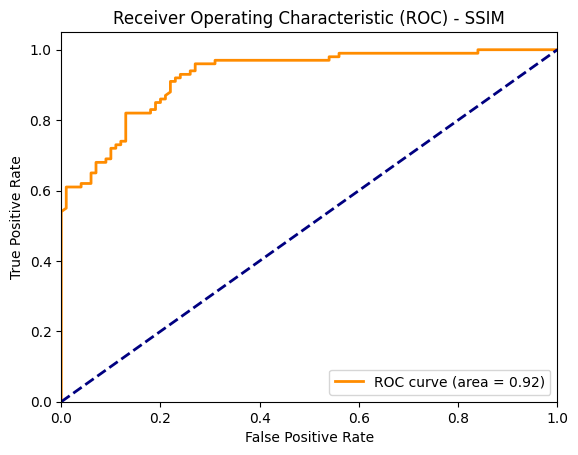
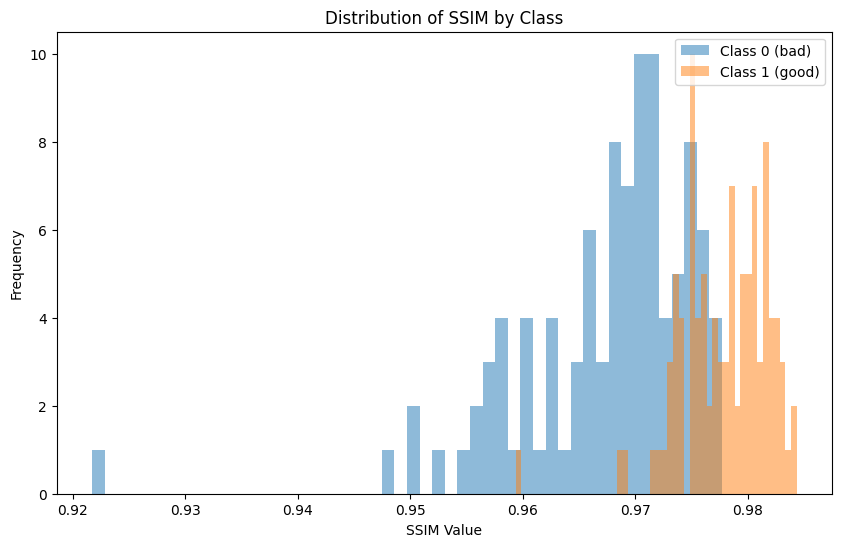

# CycleGAN "defect removal" for anomaly detection

A CycleGAN is trained to translate defective surface images into defect-free ones. The similarity between an image
and its translation then serves as an anomaly score.



## Problem

Real defect images are scarce. The idea is to teach a generator what a *clean* surface looks like, so that defects
show up as the parts it changes.

## Approach

1. **Synthetic training pairs** ([`make_synthetic_defects.py`](make_synthetic_defects.py)).
   * Random dark dots and short line segments are drawn on defect-free line-scan images, on the brightest rows of the
     region of interest.
   * Each output file holds the clean and corrupted image side by side (pix2pix "aligned" format).
2. **Training.**
   * [pytorch-CycleGAN-and-pix2pix](https://github.com/junyanz/pytorch-CycleGAN-and-pix2pix) CycleGAN.
   * Grayscale 128×128, aligned dataset, direction defective → clean.
   * 100 epochs plus 100 epochs of learning-rate decay.
3. **Scoring.**
   * MSE inside the stripe of interest, SSIM, and PSNR between each real test image and its translation.
   * ROC/AUROC and a Youden-J threshold for each metric.
   * Evaluated separately on *spot* defects and *line* defects (100 good + 100 bad test images each).
4. **Two-feature classifier.** An RBF-SVM on standardised (PSNR, SSIM).

## Results

From the notebook outputs:

| Defect type | Score | AUROC | Accuracy at optimal threshold |
|---|---|---|---|
| Spots | **SSIM** | **0.925** | 0.84 |
| Spots | PSNR | 0.743 | 0.70 |
| Spots | MSE (stripe) | 0.724 | 0.775 |
| Lines | SSIM | 0.790 | 0.75 |
| Lines | PSNR | 0.743 | 0.795 |
| Lines | MSE (stripe) | 0.680 | 0.705 |

The exploratory RBF-SVM on (PSNR, SSIM) scored **0.93 accuracy** on a held-out half of the 200 samples.



**Notes from the clean-up**

* The stripe-MSE metric originally subtracted `uint8` arrays, which wrap around. The code now casts to float first.
  The MSE rows above come from the original (overflowing) computation. SSIM and PSNR were not affected.
* The SVM features were originally stacked by row position. The code now joins the two runs on file name. The 0.93
  above comes from the original version.

## Tech

PyTorch · CycleGAN · OpenCV · scikit-image (SSIM, PSNR) · scikit-learn (ROC, SVM) · pandas

## How to run

```bash
pip install -r requirements.txt
python make_synthetic_defects.py clean_images/ train_pairs/ --roi-top 60 --roi-bottom 70 --seed 0
export DATA_ROOT=/path/to/data   # cyclegan_defects/{train_pairs,checkpoints,bad,...}
jupyter notebook cyclegan_defect_removal_anomaly_detection.ipynb
```

The line-scan images are proprietary and **not included**. Only plots and metrics are kept in the outputs.
