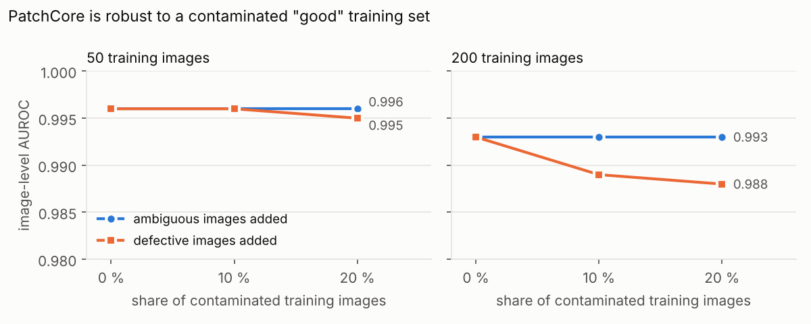
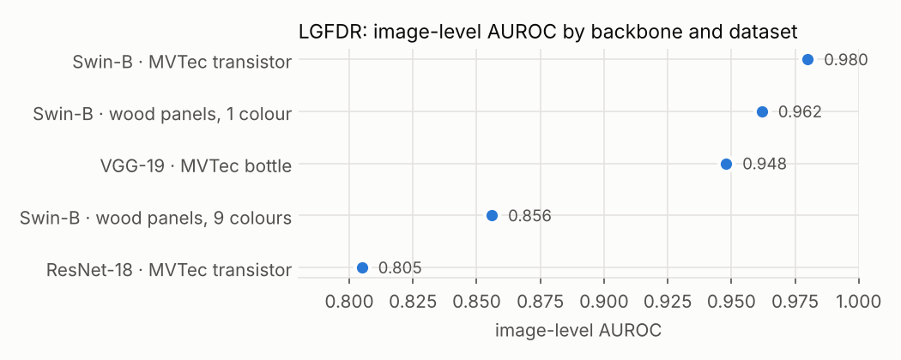

# Industrial anomaly detection: LGFDR and PatchCore

Unsupervised surface-defect detection. The models learn only from defect-free images, then flag anything unusual. Tested on the public MVTec AD benchmark and on production wood-panel images.



## Problem

On a production line, defects are rare, varied and often unseen at training time. Collecting a labelled defect set
for every product is impractical, so the models here are trained on **normal images only**. Each one outputs an anomaly
score per image (and, for LGFDR, an anomaly heat-map per pixel).

## Approach

**1. LGFDR: Local-Global Feature Dual Reconstruction**, implemented from the paper description in PyTorch.
* A pretrained backbone from `timm` (Swin-B, VGG-19 or ResNet-18) extracts the first two feature stages. These are upsampled,
  concatenated and average-pooled into a feature map *E*.
* Gaussian noise is injected into *E* during training. Two convolutional auto-encoders then reconstruct it:
  * a **local** tower made of 1×1 convolutions;
  * a **global** tower made of strided 3×3 convolutions with bilinear upsampling.
* A **Selective Reconstruction Head** fuses the two towers with channel-wise softmax weights.
* The anomaly map is `‖U − E‖₂`, upsampled to the input size. The image score is the maximum of the average-pooled map.
* Training is in two phases. The reconstruction heads train first, with the backbone frozen. When the loss plateaus,
  the backbone is unfrozen with a lower learning rate. Training stops on loss patience.

**2. PatchCore baseline and contamination study**
([Roth et al., 2022](https://arxiv.org/abs/2106.08265)).
* Setup: WideResNet-50 (layers 2 and 3), 10 % greedy coreset, nearest-neighbour scoring.
* Experiment: the "good" training set was deliberately polluted with 10 % or 20 % *ambiguous* or *defective* images.
  This measures how robust the method is to imperfect labels, which always happen in production.

## Results

All numbers below are copied from the notebook outputs.

**LGFDR**

| Notebook | Backbone | Data | Image AUROC | Pixel AUROC | Pixel AP |
|---|---|---|---|---|---|
| [`lgfdr_mvtec_transistor_swin.ipynb`](lgfdr_mvtec_transistor_swin.ipynb) | Swin-B | MVTec AD *transistor* | **0.980** | **0.911** | 0.574 |
| [`experiments/lgfdr_mvtec_bottle_vgg19.ipynb`](experiments/lgfdr_mvtec_bottle_vgg19.ipynb) | VGG-19 | MVTec AD *bottle* | 0.948 | 0.857 | 0.403 |
| [`experiments/lgfdr_mvtec_transistor_resnet18.ipynb`](experiments/lgfdr_mvtec_transistor_resnet18.ipynb) | ResNet-18 | MVTec AD *transistor* | 0.805 | 0.708 | 0.143 |
| [`lgfdr_wood_panels_single_colour_swin.ipynb`](lgfdr_wood_panels_single_colour_swin.ipynb) | Swin-B | wood panels, one colour (1 579 test images) | **0.962** | – | – |
| [`experiments/lgfdr_wood_panels_all_colours_swin.ipynb`](experiments/lgfdr_wood_panels_all_colours_swin.ipynb) | Swin-B | wood panels, 9 colours (9 262 test images) | 0.856 | – | – |

The wood-panel labels are image-level only, so no pixel-level metrics are available for those rows. A single model
for all nine panel colours is clearly harder than one model per colour (0.856 vs 0.962).



**PatchCore** ([`patchcore_baseline_and_contamination_study.ipynb`](patchcore_baseline_and_contamination_study.ipynb)),
image-level AUROC:

| Dataset / setting | AUROC | Accuracy at optimal threshold |
|---|---|---|
| Product A, area-scan camera | 0.943 | 0.918 |
| Product A, line-scan camera | 0.993 | 0.962 |
| Product A, line-scan, downscaled to 32×32 | 0.995 | 0.981 |
| Product C, line-scan (subtle defects) | 0.620 | 0.505 |
| 50 clean training images → +10 % / +20 % ambiguous | 0.996 → 0.996 / 0.996 | |
| 50 clean training images → +10 % / +20 % defective | 0.996 → 0.996 / 0.995 | |
| 200 clean training images → +10 % / +20 % ambiguous | 0.993 → 0.993 / 0.993 | |
| 200 clean training images → +10 % / +20 % defective | 0.993 → 0.989 / 0.988 | |

**Takeaways**
* PatchCore barely degrades when up to 20 % of the "good" training images are actually ambiguous or defective
  (AUROC ≥ 0.988 in every setting).
* Downscaling to 32×32 px did not hurt AUROC (0.995), which makes edge deployment plausible.
* The low-contrast Product C remains an open problem for this method (0.620).

## Tech

PyTorch · timm (Swin Transformer, VGG, ResNet) · scikit-learn metrics · PatchCore / FAISS · MVTec AD

## How to run

```bash
pip install -r requirements.txt
export DATA_ROOT=/path/to/data   # must contain mvtec_ad/<category>/{train,test,ground_truth}
jupyter notebook lgfdr_mvtec_transistor_swin.ipynb
```

* **MVTec AD** is public. Download it from <https://www.mvtec.com/company/research/datasets/mvtec-ad> and extract it
  to `$DATA_ROOT/mvtec_ad/`.
* **Wood-panel and Product A/B/C data are proprietary and are not included.** Those notebooks document the method and
  the logged results. Product names were anonymised, and product images were removed from the outputs.
* A GPU is strongly recommended. Swin-B training on MVTec *transistor* took roughly 250 epochs on a Colab T4.
* The PatchCore notebook clones the upstream
  [patchcore-inspection](https://github.com/amazon-science/patchcore-inspection) repository. The original runs used a
  personal fork with small I/O changes, so the commands may need minor adaptation.
* No model weights are committed (see the root `.gitignore`).
