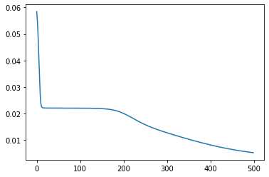

# Multilayer perceptron with back-propagation from scratch (NumPy)

A fully connected neural network written without a deep-learning framework: forward pass, back-propagation and
online gradient descent, tested on the Iris dataset.



## Approach

* An `MLP` class that supports any list of hidden-layer sizes, with sigmoid or linear activations.
* Per-sample back-propagation of the error through the activation derivatives, with gradient-descent weight updates.
  The MSE is tracked per epoch.
* Experiments on Iris (4 features, 3 one-hot classes, 67/33 split) vary activation, width, depth and learning rate.

## Results

From the notebook outputs. The score is scikit-learn's average precision of the network outputs against the one-hot
labels, not classification accuracy.

| Hidden layers | Activation | Learning rate | Average precision |
|---|---|---|---|
| [3] | sigmoid | 0.01 | 0.759 |
| [3] | linear | 0.01 | 0.777 |
| **[6]** | sigmoid | 0.01 | **0.986** |
| [3, 3] | sigmoid | 0.01 | 0.487 |
| [3] | sigmoid | 0.1 | 0.759 |

There is no fixed random seed, so re-runs vary.

## Tech

NumPy · scikit-learn (dataset, metrics) · Matplotlib

## How to run

```bash
pip install -r requirements.txt
jupyter notebook mlp_backprop_from_scratch.ipynb
```
