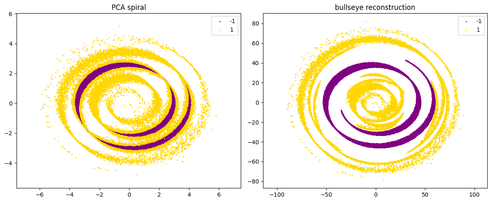
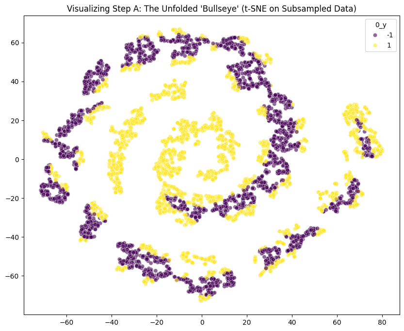

# Classifying a 10-D "folded bullseye" dataset and reverse-engineering how it was generated

A take-home data-science assignment with two parts:
* benchmark six classifiers with leakage-safe tuning (best: **Random Forest, 99.3 % holdout accuracy**);
* undo the data-generating process, recovering a 2-D bullseye from 10-D noisy data with PCA and clustering.



## Problem

The data has 54 000 samples, 10 numeric features and balanced labels (−1 / +1). It was generated in three steps:
(a) draw a bullseye of alternating classes, (b) fold it into a spiral, (c) embed it in 10-D with noise.

The two tasks:
1. Predict labels for an unlabelled test set.
2. Reverse steps (c) and (b).

## Approach

**Classification**
* Stratified 80/20 train/holdout split. `StandardScaler` is fitted on the training split only.
* EDA: distributions, correlations, and a t-SNE view of a 5 000-point subsample.
* Six model families: Gradient Boosting, RBF-SVM, MLP, Random Forest, XGBoost and k-NN.
  * Each is tuned with `RandomizedSearchCV` (3-fold) on a 5 000-point subsample.
  * They are then compared with 5-fold stratified CV on the full training split.
* The winner is checked once on the untouched holdout, then refit on all labelled data for the test predictions.

**Reverse engineering** ([`reverse_pipeline.py`](reverse_pipeline.py))
* Step (c): PCA to 2-D recovers the spiral. t-SNE, Isomap, LLE, spectral embedding and kernel PCA all confirm it.
* Step (b): polar coordinates, then per-class k-means on the radius (1 ring for class −1, 2 for class +1), then each
  ring is rescaled to a concentric band while its angle is kept.
* [`bullseye_spiral_generator.py`](bullseye_spiral_generator.py) re-implements the forward process to produce a
  similar synthetic dataset.

## Results

From the notebook outputs. 5-fold CV runs on the 43 200-sample training split:

| Model | CV accuracy (mean ± std) | CV time |
|---|---|---|
| **Random Forest** | **0.9918 ± 0.0013** | 185 s |
| Gradient Boosting | 0.9905 ± 0.0011 | 401 s |
| k-NN | 0.9888 ± 0.0012 | 0.9 s |
| RBF-SVM | 0.9885 ± 0.0006 | 54 s |
| MLP | 0.9879 ± 0.0036 | 30 s |
| XGBoost | 0.9865 ± 0.0012 | 3.3 s |

The **holdout accuracy of the selected Random Forest is 0.9931** (10 800 samples). The 2-D PCA projection shows the
spiral directly (left panel of the figure above).



## Tech

scikit-learn (pipelines, `RandomizedSearchCV`, `StratifiedKFold`, PCA, t-SNE, Isomap, LLE, spectral embedding, k-means)
· XGBoost · pandas · seaborn / Matplotlib

## How to run

```bash
pip install -r requirements.txt
export DATA_ROOT=/path/to/csvs   # input_train.csv, label_train.csv, input_test.csv
jupyter notebook spiral_classification_benchmark.ipynb
python reverse_pipeline.py       # expects input_train.csv / label_train.csv in the working directory
```

* The assignment's original CSVs are not redistributed. `bullseye_spiral_generator.py` builds a comparable dataset.
* The notebook and both scripts were smoke-tested end-to-end on such generated data.
