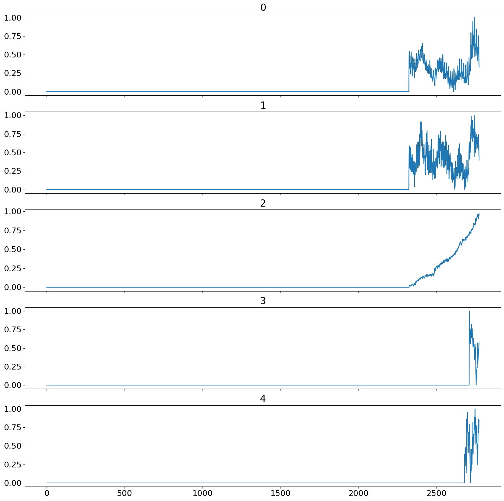

# Time-series forecasting with a BiLSTM + Conv1D model

A university deep-learning challenge (team of four): forecast **48 000 univariate time series**. The best model was
autoregressive and reached **MSE 0.00536 on the hidden test set**.



## Problem

The dataset has 48 000 series from 6 categories, each up to 2 776 steps long with its own valid start index. The task
was to predict the next 9 steps (phase 1) and then 18 steps (phase 2). Submissions were scored on a hidden test set.

## Approach

* Per-series min-max normalisation.
* Sliding windows of 200 past samples, with stride 5 or 10.
* Model: Bidirectional LSTM(64) → Conv1D(128, k=3) → Conv1D(1, k=3) → crop to the horizon. Trained with MSE, Adam,
  early stopping and LR reduction on plateau.
* Two forecasting strategies:
  * **Direct**: the model outputs all 9 future steps at once.
  * **Autoregressive**: the model predicts 3 steps, appends them to the input window, and repeats up to 18 steps
    ([`submission_model.py`](submission_model.py)).

## Results

The test scores below come from the team's challenge report. The notebook only contains training logs.

| Model | Window / stride / horizon | Hidden-test MSE |
|---|---|---|
| Direct | 200 / 10 / 9 | 0.00740 |
| Direct | 200 / 5 / 9 | 0.00674 |
| **Autoregressive** | 200 / 5 / 3 → 18 | **0.00536** |
| Conv1D in front of the BiLSTM | — | 0.00710 |

* The notebook's training log (direct model) reaches a validation MSE of 0.0049 before the run was stopped.
* A smaller stride (more, overlapping windows) helped.
* Autoregressive forecasting generalised best.

## Fixes made during clean-up

* `build_sequences` had a syntax error (`assert len(x) = window`).
* Its padding branch had a shape bug.
* It transposed the full 2 776 × 48 000 frame on every iteration. It now slices each series directly.
* Hard-coded sample counts and batch sizes were replaced by values derived from the data.
* The notebook was smoke-tested end-to-end on synthetic series with TensorFlow 2.15.

## Tech

TensorFlow / Keras (Bidirectional LSTM, Conv1D, callbacks) · NumPy · pandas · Matplotlib

## How to run

```bash
pip install -r requirements.txt
export DATA_ROOT=/path/to/data   # training_data.npy, valid_periods.npy, categories.npy
jupyter notebook bilstm_conv1d_forecasting.ipynb
```

The challenge data is not redistributed.
