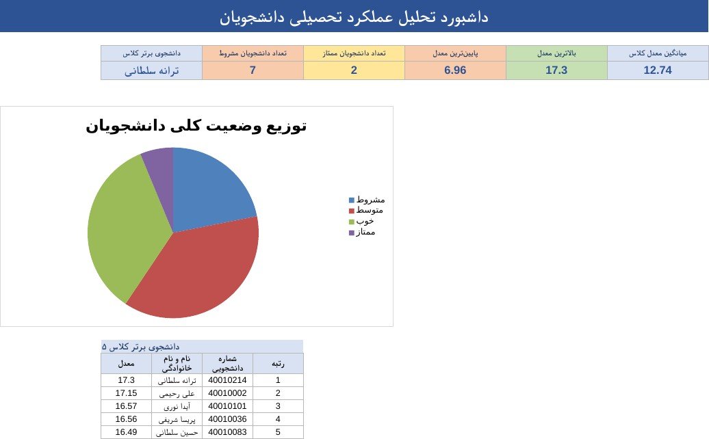

# Student performance analysis system in Excel

An Excel take-home task from a job application: a workbook that records grades for a class, computes every result
with formulas and presents them on a dashboard that updates by itself when the data changes. The deliverables
(workbook, report and slides) are in Persian.

## What the workbook does

`Project1.xlsx` has four sheets, all linked by formulas (no result is typed in by hand):

| Sheet | Contents |
|---|---|
| **Students** | 32 students: ID, name, major, entry year, gender, e-mail |
| **Scores** | 160 rows (5 courses × 32 students): coursework, midterm and final marks, weighted final grade and pass/fail |
| **Analysis** | Per-student average, best/worst grade, courses passed/failed and overall standing; class statistics, pass rate and mean per course; top-5 ranking |
| **Dashboard** | KPI tiles and three charts: mean grade per course, distribution of standings, pass/fail count per course |

Key formulas:

* Final grade `=ROUND(0.2*Coursework + 0.3*Midterm + 0.5*Final, 2)`, pass if ≥ 10.
* `AVERAGEIF`, `MAXIFS` / `MINIFS`, `COUNTIFS` for per-student and per-course statistics.
* Nested `IF` to band each student's average into four standings.
* `RANK.EQ` + `COUNTIF` for a tie-free ranking, then `INDEX` / `MATCH` to build the top-5 table.
* Conditional formatting to highlight failing grades and standings.

## Results

From the report, on the sample data:

| Indicator | Value |
|---|---|
| Class average | 12.74 / 20 |
| Highest / lowest average | 17.3 / 6.96 |
| Excellent / on probation | 2 students (6.3 %) / 7 students (21.9 %) |
| Course with the highest fail rate | Basic Physics, 34.4 % |
| Course with the highest mean | General Mathematics, 13.22 |
| Correlation, coursework vs final grade | 0.69 |

The student records are sample data, not real people.

## Files

| File | Purpose |
|---|---|
| `Project1.xlsx` | The workbook |
| `Report.pdf` | Four-page report: structure, formulas, dashboard and answers to the analysis questions |
| `Presentation.pptx` | Seven-slide presentation |

## Tech

Microsoft Excel (formulas, conditional formatting, charts, dashboard design)
