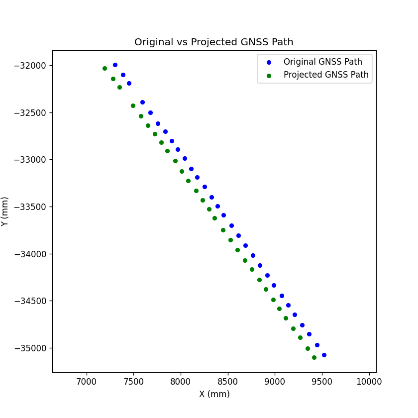
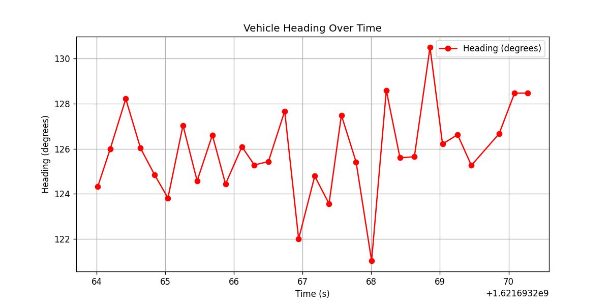

# GNSS antenna ground projection and vehicle heading

A Python take-home task from a job application. A GNSS antenna is mounted 1.5 m above the ground on a vehicle that
rolls and pitches as it drives, so the raw GNSS fix is not the point on the ground under the vehicle. The script
estimates the vehicle heading from consecutive fixes and projects each fix down to the ground using roll and pitch.



## Approach

* **Heading.** `atan2(Δy, Δx)` between consecutive GNSS points. The last point has no successor, so it reuses the
  previous heading.
* **Projection.** Roll and pitch give a sideways and a forward lean of the antenna mast: the horizontal offset is
  `h · sin(pitch)` along the heading and `h · sin(roll)` across it, with `h = 1500 mm`. The offset is rotated from the
  vehicle frame into global X/Y using the heading and subtracted from the GNSS position.
* Plain NumPy vectorised over all samples; Matplotlib for the plots.

## Results

On the provided log (30 fixes over 6.3 s, roll 3.6° to 4.1°, pitch −2.1° to −0.4°):

| Quantity | Value |
|---|---|
| Heading range | 121.0° to 130.5° |
| Antenna-to-ground offset | 94 mm to 114 mm (mean 104 mm) |

The vehicle leans steadily to one side, so the projected path is a parallel track shifted about 10 cm from the raw
GNSS path.



## Files

| File | Purpose |
|---|---|
| `main.py` | Reads `gnss_data.csv`, runs the calculations, saves the plots and `output_gnss_data_with_projections.csv` |
| `calculations.py` | `calculate_headings` and `calculate_gnss_projection` |
| `visualize.py` | Path and heading plots |
| `gnss_data.csv` | Input log: `time_s, x_mm, y_mm, roll_deg, pitch_deg` |

## Tech

Python 3 · NumPy · pandas · Matplotlib

## How to run

```bash
pip install -r requirements.txt
python main.py
```
